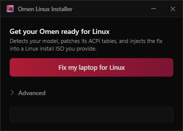
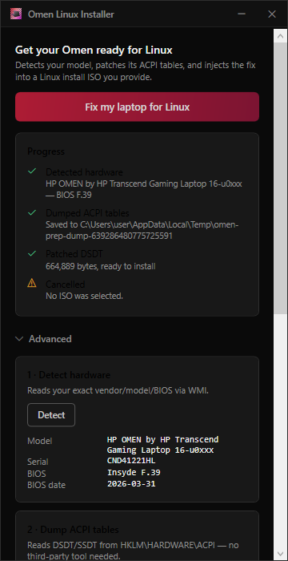
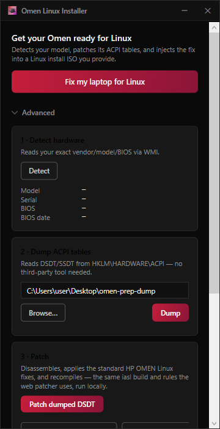

# Omen Linux Installer

Windows tool for getting Linux onto an HP OMEN without fighting the ACPI tables by hand.

It dumps your DSDT from Windows, patches it (same rules as the [online patcher](https://omenlinux.alessandromarcon.dev/acpi-patcher/)), and injects that into a Linux install ISO. After you install, a couple of scripts on the ISO make the fix permanent and can set up keyboard RGB.

Part of [OmenLinux](https://omenlinux.alessandromarcon.dev/).



## Does this work with my distro?

We've actually tested **Fedora Workstation**, **Ubuntu desktop**, and **Arch**. Other distros might work fine too if the ISO has a normal initrd we can find (`casper`, `LiveOS`, etc.) - they just haven't been tested yet. If you try one and it works (or breaks in a useful way), open an issue.

## How to use it

You need the OMEN on Windows, a Linux ISO, and a USB stick (8GB+). Rufus, Etcher, or `dd` for flashing.

1. Get `OmenPrep.exe` from [Releases](https://github.com/OmenLinux/omen-linux-installer/releases) (or build it, see bottom).
2. Run it on the laptop.
3. Hit **Fix my laptop for Linux**, pick your stock ISO, save the `-omen.iso`.
4. Flash **that** file to the USB. In Rufus use **DD mode**, not ISO mode - hybrid images get weird otherwise.
5. Boot the stick (UEFI, Secure Boot off for the first install is easiest), install Linux normally.
6. Run the scripts from the ISO so the fix survives reboot.



There's an Advanced panel if you want to dump/patch/inject step by step. Most people don't need it.



### After install (don't skip this)

While you're still in the live session, with the new root at `/mnt`:

```bash
# Ubuntu live usually has the ISO at /cdrom
sudo bash /cdrom/apply-omen-acpi.sh /mnt

# Fedora live - stick is usually under /run/media
sudo bash /run/media/$USER/*/apply-omen-acpi.sh /mnt
```

Reboot into the installed system, mount the USB again, then:

```bash
sudo bash /run/media/$USER/*/post-install-omen.sh   # Fedora-ish path
# or
sudo bash /media/$USER/*/post-install-omen.sh       # Ubuntu-ish path
```

That locks in ACPI for future kernels, tries to un-break Intel iGPU probe on some newer Fedora kernels, and builds the RGB DKMS module if headers exist.

Flags if you only want one piece:

```bash
sudo bash post-install-omen.sh --acpi-only
sudo bash post-install-omen.sh --rgb-only
sudo bash post-install-omen.sh --gpu-only
```

Reboot once more.

### Did it work?

```bash
journalctl -k | grep -i 'Table Upgrade'
ls /sys/devices/platform/omen-rgb-keyboard/
echo rainbow | sudo tee /sys/devices/platform/omen-rgb-keyboard/rgb_zones/animation_mode
```

## BIOS notes

Esc/F10 into setup: UEFI boot, Secure Boot off at least until things work. F9 for the one-shot boot menu if the stick doesn't show up.

## Common problems

- **No EFI entry / stick won't boot** - reflash with Rufus DD mode. Don't reuse an old `-omen.iso`; patch again from the original ISO with a current build of the app.
- **GRUB can't find `/boot`, or live crashes** - same fix: fresh patch + DD flash.
- **RGB missing** - need `kernel-devel`/headers matching `uname -r`. Try `--rgb-only`. Secure Boot may want a MOK enrollment for DKMS.
- **Desktop runs like a slideshow (Fedora)** - Intel stuck on `simpledrm`. `--gpu-only`, reboot, check `lspci -nnk` for `i915`.
- **NVIDIA** - install `akmod-nvidia` from RPM Fusion yourself. Panel is usually on Intel; dGPU is offload. Not something this tool handles.

## Building

.NET 10 SDK:

```powershell
git clone https://github.com/OmenLinux/omen-linux-installer.git
cd omen-linux-installer
.\publish.ps1
# artifacts\OmenPrep.exe
```

```powershell
dotnet test .\windows-tool.Tests\OmenPrep.Tests.csproj -c Release
```
